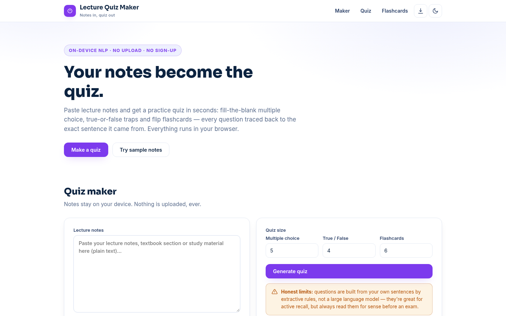

# Lecture Quiz Maker — Turn Notes into Quizzes & Flashcards

**Live:** https://akash991833.github.io/lecture-quiz-maker/

Paste lecture notes and get a practice quiz in seconds: fill-the-blank multiple choice, true-or-false traps with subtle number and negation swaps, and flip flashcards — every question traced back to the exact sentence it came from. Runs entirely in your browser. No upload, no sign-up, no API key.



## Features

- **Multiple choice** — key terms become cloze blanks with plausible same-length distractors from your own notes
- **True / False traps** — statements mutated by dropping a "not", adding one, or doubling a number, each with an explanation of the trick
- **Flashcards** — tap-to-flip cards built from the most keyword-dense sentences
- **Source citations** — every question shows the exact sentence it was built from
- **Scoring** — instant feedback per question plus a final score with a retake button
- **Export** — download the whole quiz as Markdown
- **Sample packs** — biology, history and CS notes to try instantly
- **PWA** — installable, works fully offline
- **Dark & light themes**, responsive on mobile and desktop

## How it works

1. **Sentence splitting** — notes are broken into clean sentences (5–60 words)
2. **Keyword ranking** — term frequency × document frequency finds the load-bearing terms
3. **Key sentences** — sentences are scored by keyword density (normalized by length)
4. **Question building** — MCQs blank out the top keyword; true/false mutates negations and numbers; flashcards quote the densest sentences
5. All in `quiz-engine.js` — pure JavaScript, deterministic rules, no model download

## Honest limits

This is extractive NLP, not an LLM: questions come from your own sentences by rules, so they are only as good as the notes. Distractors are same-length words from the notes, which occasionally makes an obviously-wrong option. True/false mutations can produce awkward phrasing. It understands English only and has no notion of correctness beyond your text — read questions for sense before relying on them for an exam.

## Tech

Vanilla HTML/CSS/JS. No build step, no backend, no tracking.

## Run locally

```bash
python3 -m http.server 8000
# open http://localhost:8000
```

Built by [Akash Vishwakarma](https://github.com/AKASH991833). Free to use — no sign-up, no card.

## Stacks

- **Live demo (this repo root):** HTML/CSS/JS — instant quiz generation from pasted notes, on-device.
- **Python pipeline (`python/`):** spaCy-based generation with noun-chunk keyphrases, entity distractors and auditable source sentences. See `python/README.md`.
